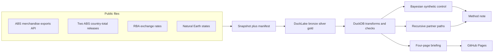

# China trade thaw

After the 2020–23 restrictions, how exposed are Australian goods exports to China, what has come back, and where does a second buyer already exist?

The question is for exporters, state trade agencies and policy makers. It is not a forecast and it is not advice on a contract.

[](https://github.com/LuciferDataEngineer/china-trade-thaw/actions/workflows/ci.yml)
[](https://github.com/LuciferDataEngineer/china-trade-thaw/actions/workflows/pages.yml)
[](LICENSE)

Live briefing: [https://luciferdataengineer.github.io/china-trade-thaw/](https://luciferdataengineer.github.io/china-trade-thaw/)

Figures below are from the snapshot taken **21 November 2026, 9:37 am AEDT**. Goods months run to **September 2026**. Exchange rates run to **20 November 2026**.

## Headline result

**China bought 35.2 percent of Australia's goods exports in the year to September 2026, $191.9 billion of $544.6 billion. A tenth of that is $19.2 billion. Western Australia carries $13.6 billion of it.**

| | Figure | What it is |
| --- | ---: | --- |
| Latest year, sales to China | **$191.9 billion** | October 2025–September 2026 |
| Share of all goods exports | **35.2%** | Same window. It was 12% in 2006, 38.0% in 2019, 29.1% in 2022 and 33.6% in 2025 |
| Iron ore to China, 2025 | **$103.6 billion** | 59% of that year's China sales |
| Five biggest buyers | **65%** | Of all goods exports in the latest year |
| If China sales fall by a tenth | **$19.2 billion** | Arithmetic, not a price model. Western Australia is $13.6 billion of it |
| Western Australia's reliance | **57.1%** | Of that state's goods exports, latest year |
| Back near the 2017–19 China level | **5 of 8 groups** | Barley, shellfish, beef, cotton, copper ores |
| Part way back | **Wine 68%, coal 71%** | Of the 2017–19 average, in 2025 |
| Still well short | **Timber logs, 21%** | Of the 2017–19 average, in 2025 |
| Recorded gap during the blocks | **$41.2 billion** | Sales below the 2017–19 average. Coal is $26.5 billion of it |
| Coal's largest other buyer, 2025 | **Japan, $19.6 billion** | Larger than China's $9.4 billion |
| Iron ore's next buyer, 2025 | **Japan, $6.5 billion** | About 6% of China's $103.6 billion |

The pages use recorded sales. A Bayesian comparison with goods that were not blocked is in [INSIGHTS.md](INSIGHTS.md). The same comparison also moves for wool, which was not blocked, so it is not the number on the pages.

## Architecture



CI rebuilds the pages from the committed snapshot. It does not call ABS or the RBA. Refreshing the snapshot is `make snapshot`.

DuckLake's catalog is Postgres. The Parquet files sit on an S3-compatible store, RustFS, the same choice as the previous project after MinIO images were not anonymously pullable. Each ABS country-total release is a lake snapshot. Time travel reads the August 2026 release back after the September release has replaced it.

## Tech stack

| Piece | Why it is here |
| --- | --- |
| DuckDB | The warehouse. Joins, annual totals, concentration and the state shock are SQL. |
| DuckLake | Table snapshots so an ABS revision is a version, not an overwrite. Postgres holds the catalog. RustFS holds the files. |
| Postgres in Docker | Only the DuckLake catalog. No hosted database. |
| RustFS | S3-compatible object store for the lake files. Apache-2.0. |
| Recursive SQL | Partner paths: China, then the good, then who else buys it. DuckPGQ is not published for DuckDB 2.0.1. |
| CausalPy and PyMC | Bayesian synthetic control for the blocked goods, with a wool placebo. The pages do not use the dollar gap, because the placebo also moves. |
| Open Data Contract Standard | `contracts/gold-exposure.odcs.yaml`, linted with datacontract-cli. The CLI's data test pins DuckDB 1.5, so the SQL rules run in-process on DuckDB 2. |
| Pandera | Frame checks on the state table between the extract and the pages. |
| Arrow Flight | A small read-only SQL endpoint over a DuckDB file. The test asks for the state rows. |
| Hypothesis, pytest, ruff | Share arithmetic, the flight endpoint, and the briefing in Chromium at desktop and phone width. |
| Testcontainers | Postgres and RustFS for the lake test, plus the same two images as GitHub Actions service containers. |
| GitHub Pages | Static four-page briefing. |

## What's new vs the previous project

Project 17, [gas-reservation-gap](https://github.com/LuciferDataEngineer/gas-reservation-gap), asked whether holding back a fifth of Gladstone's LNG would cover the southern winter gap. It used dlt, DuckDB, Ibis, Iceberg with a Nessie branch, Feldera, and DoWhy with EconML.

This project asks a different question, about goods exports rather than gas molecules, and changes the engine set:

- DuckLake snapshots replace the Nessie audit branch. The catalog is Postgres, which that project deliberately avoided, because DuckLake needs a catalog database and the files are not in it.
- A recursive graph walk replaces Feldera's incremental sum. The check is "who else already buys this good", not "the streaming total matches DuckDB".
- CausalPy's Bayesian synthetic control replaces the linear double machine-learning price estimate. The placebo is a good that was not blocked.
- Data contracts and Pandera replace the hand-written SQL check list, and the SQL checks are still there.
- Arrow Flight is a serving step the gas project did not have.
- RustFS stays. It was the object store that could be pulled without an account.

DuckDB is still the engine that answers the question.

## Data sources

All of these are free to download with no API key. Hashes, byte sizes and the access time are in [`data/snapshot/manifest.json`](data/snapshot/manifest.json).

| Publisher | What | URL | Licence | Coverage in this snapshot | Accessed |
| --- | --- | --- | --- | --- | --- |
| Australian Bureau of Statistics | Merchandise exports by SITC commodity, destination and state. Dataflow `ABS,MERCH_EXP,1.0.0` | https://data.api.abs.gov.au/rest/data/ABS,MERCH_EXP,1.0.0/ | CC BY 4.0 | Monthly, January 2006–September 2026. 382,182 observations after keeping 3-digit commodities and totals | 21 Nov 2026, 9:37 am AEDT |
| Australian Bureau of Statistics | Table 14a, merchandise exports by country, August 2026 release | https://www.abs.gov.au/statistics/economy/international-trade/international-trade-goods/aug-2026/5368014a.xlsx | CC BY 4.0 | Country-months from January 2024, the vintage before the September revisions | same |
| Australian Bureau of Statistics | Table 14a, September 2026 release | https://www.abs.gov.au/statistics/economy/international-trade/international-trade-goods/sep-2026/5368014a.xlsx | CC BY 4.0 | Same table, revised back to March 2026, plus September | same |
| Reserve Bank of Australia | Exchange rates, F11 historical and F11.1 daily | https://www.rba.gov.au/statistics/tables/csv/f11-data.csv and https://www.rba.gov.au/statistics/tables/csv/f11.1-data.csv | Free public statistical tables. Acknowledge the RBA. Not marked Creative Commons on the site | AUD per USD and AUD per yuan, January 2010–20 November 2026. Monthly through 2022, then daily | same |
| Natural Earth | 1:50m admin-1 boundaries, Australia only | https://raw.githubusercontent.com/nvkelso/natural-earth-vector/master/geojson/ne_50m_admin_1_states_provinces.geojson | Public domain | Eight states and territories. The 110m file on GitHub currently contains only US states, so the 50m file is the one that includes Australia | same |

DFAT's country-by-commodity workbooks are the usual annual cross-tab and are also CC BY. The department's website did not respond from the machine that built this snapshot, and the ABS dataflow is the monthly source those workbooks are drawn from, with state as well. The snapshot uses the ABS file.

## Cleaning and transformation

1. API values are thousands of Australian dollars. They are stored as dollars (`value × 10³`).
2. Commodity totals keep 3-digit SITC codes. One- and two-digit parents are dropped so a chart does not add barley to "cereals" to "food".
3. Buyer shares use individual countries. APEC, ASEAN, the EU, the OECD and the developing-country totals are groupings, not markets. "No country details" is not a market either.
4. A finished year has 12 months of the national total. 2026 stops at September and is not drawn as a full year. The cards use October 2025–September 2026.
5. For the eight blocked groups, a missing month of sales to China is treated as no recorded sales. ABS does not publish a zero, and those gaps are the stoppages: barley in 2021 and 2022, coal in 2022, copper ores in 2021. Other series keep only published months. Gold has missing years and is not a comparison good. Natural gas, $60.2 billion in 2025, is not published by destination.
6. The state shock is 10 percent of that state's recorded sales to China in the latest year. It is not a model of prices or of what other buyers would take.
7. "Back" means 2025 reached at least 90 percent of the 2017–19 average. Part way is 40 to 90 percent. The recorded gap during the blocks is the sum of how far each blocked year sat below that average.
8. The September 2026 API figure for China matches the September workbook within $1 million. The build stops if it does not.

## Data model

Bronze, committed as Parquet under `data/snapshot/`:

| File | Grain |
| --- | --- |
| `merch_month.parquet` | Commodity, destination, state, month, Australian dollars |
| `country_vintage.parquet` | Release (August or September 2026), country, month, $ million |
| `fx_daily.parquet` | Day, AUD per USD, AUD per yuan |
| `labels.parquet` | ABS names for commodities, countries and states |
| `au_states.geojson` | One feature per state or territory |

Silver and gold are built in DuckDB and are not committed. The lake test writes the two country vintages to `bronze.country_month` and reads the first snapshot back.

| Gold table | Grain |
| --- | --- |
| `concentration_year` | Finished calendar year: China share, top-five share, HHI |
| `concentration_latest` | One row for October 2025–September 2026 |
| `commodity_latest` | 3-digit commodity, sales to China in that window |
| `china_goods_year` | Blocked group and year, with unpublished months filled as zero |
| `state_shock` | State: total goods, sales to China, 10 percent of the China sales |
| `substitute` | Good, other buyer, 2025 purchases, rank |
| `revision_cell` | Country, month, August release, September release, difference |
| `model_good` / `model_year` | Synthetic-control fit. Used in the method note, not on the pages |

## How to run

Python 3.12. A compiler is needed the first time the Bayesian fit builds its numeric code (`g++` and Python headers).

```bash
python3 -m venv .venv
.venv/bin/pip install -r requirements-dev.txt
make test
make pipeline
```

`make pipeline` reads only `data/snapshot/` and rewrites `site/` and `INSIGHTS.md`.

Refresh the snapshot from the public sources. This uses the network and is not part of CI:

```bash
make snapshot
make pipeline
```

The briefing is static files in `site/`. From that directory, `python3 -m http.server` is enough. Links are relative, which is what GitHub Pages needs for a project site.

Postgres and RustFS, for the lake check:

```bash
docker compose up -d postgres rustfs
```

Postgres is on port 5432 with user `postgres`, password `postgres`, database `ducklake`. RustFS is on port 9000 with `rustfsadmin` / `rustfsadmin`. Then:

```bash
make lake
```

`make lake` runs the Testcontainers test when Docker is available, and the service-container test when `LAKE_PG_HOST` and `LAKE_S3_ENDPOINT` are set. GitHub Actions sets those for the service job and also runs Testcontainers.

One-command page rebuild in Docker, without the lake:

```bash
docker compose build pipeline
docker compose run --rm pipeline
```

## Testing and CI

[`.github/workflows/ci.yml`](.github/workflows/ci.yml) runs on pull requests and on main:

1. **lint-unit** — ruff, Hypothesis checks on shares and the 10 percent shock, the flight endpoint, and the snapshot hashes.
2. **lakehouse** — Postgres and RustFS as service containers, then the same pair started by Testcontainers. Both load the August release, snapshot it, replace it with the September release, and read August back.
3. **briefing** — rebuild the four pages from the snapshot, including the Bayesian fit, then Playwright at 1280×800 and 390×844. A page fails if a chart label overlaps another label, sticks out of its chart, or the browser reports a console error.

[`.github/workflows/pages.yml`](.github/workflows/pages.yml) rebuilds `site/` and deploys it with `actions/deploy-pages` on push to main.

The Bayesian fit uses seed 18, 2 chains, 200 tuning steps and 200 draws. Re-running it can move the method-note dollars slightly. The pages do not depend on those draws. They use the recorded totals.

`datacontract lint` checks the contract file. `datacontract test` is not run in CI: installing its DuckDB extra downgrades DuckDB to 1.5, and DuckDB 2 removed `fetch_arrow_table`, which that test still calls. The contract's SQL rules are executed by the build.

## Limitations

- Goods only. Education, tourism and other services are not in this file.
- Dollars are nominal. The exchange-rate chart is context. The Australian dollar was about 7 percent weaker against the US dollar in 2025 than in 2019, so Australian-dollar receipts sit a little higher than US-dollar prices.
- Wine is the official group "alcoholic beverages", which includes beer and spirits. Shellfish includes prawns as well as lobster. The pages say so.
- About $18.9 billion of the latest year's sales to China are in a combined confidential item. Natural gas is missing from every destination split.
- Beef was a suspension of some plants, not a closed market. Recorded beef sales to China did not fall below the 2017–19 average.
- The 10 percent figure is a tenth of recorded sales. It does not say what price or what other buyer would do.
- The synthetic-control dollar gap is not on the pages. Wool, which was not blocked, also shows a large gap, because the comparison basket includes iron ore and iron ore boomed. See [INSIGHTS.md](INSIGHTS.md).
- Not operational advice. Do not price a cargo or brief a negotiation from this page.

## Next steps

- When ABS publishes the October 2026 merchandise release, `make snapshot` and reload both Table 14a vintages so the revision report moves forward a month.
- A free commodity-by-country file for natural gas, if one is published without a key, would show whether China is inside the $60 billion that currently has no destination.
- If DuckPGQ ships a DuckDB 2.0 build, the recursive walk can be checked against the property-graph query. The fallback is documented in the method note.
